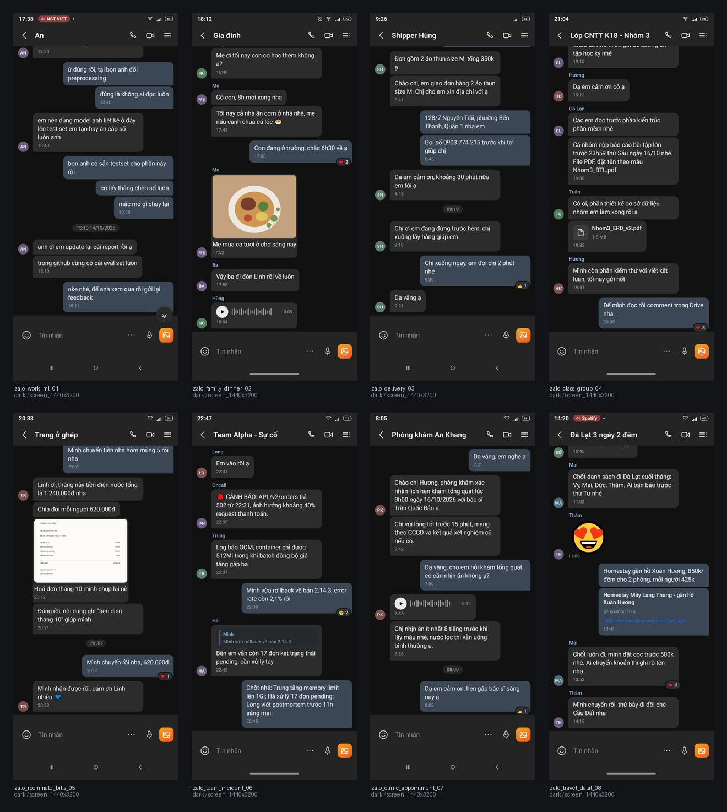
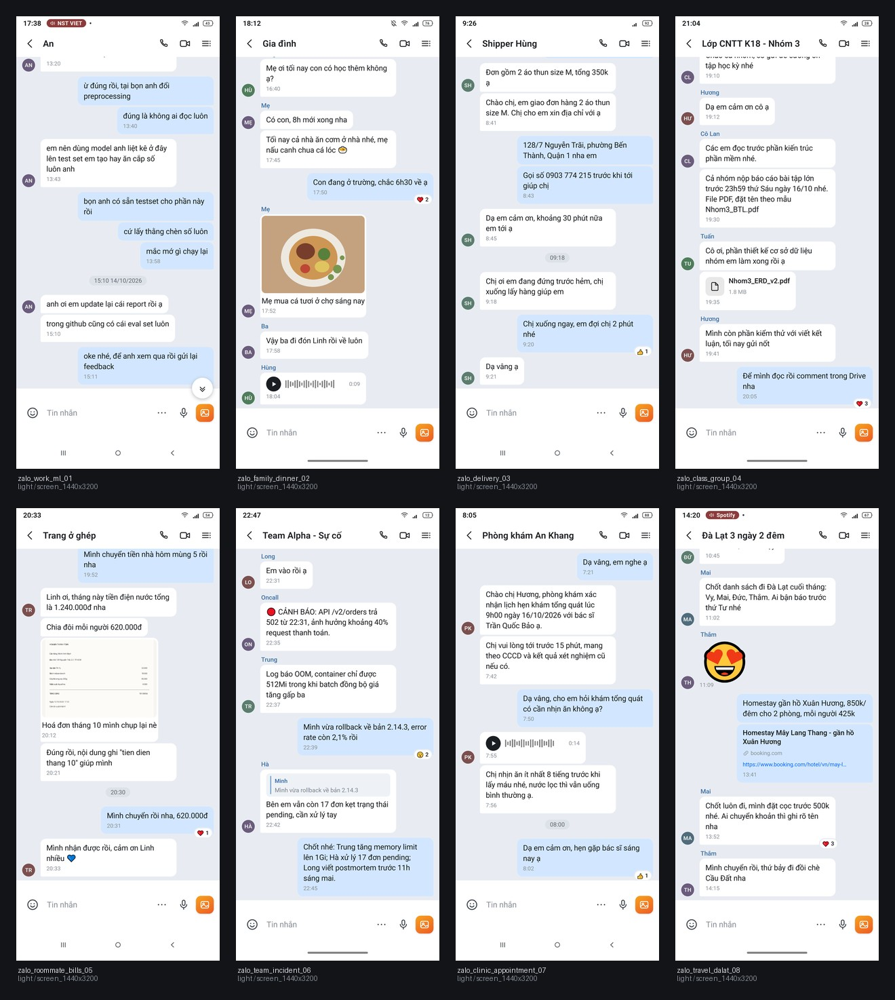

# Chat screenshot simulator

Synthetic **1440×3200 Android Zalo chat screenshots** with a machine-readable
record of which part of the conversation was captured.

The same dialogue format can also render Facebook Messenger style chat screens.
The Messenger layout is based on the light and dark Pixel 10 captures in
`out/pixel10`. Production output uses the same 1440×3200 resolution as Zalo:

```bash
python src/generate.py --input dialogues/01_work_ml.json --app messenger \
  --devices screen_1440x3200 --themes light,dark --out out/messenger
python src/check.py --manifest out/messenger/manifest.jsonl
```

`--app` defaults to `zalo`. Messenger filenames and manifest IDs start with
`messenger_`; manifest rows retain the input dialogue ID as `source_id`, so both
apps can share an output directory. The reference captures are used only for
layout and color guidance; rendered conversations use the project's synthetic
dialogue data and assets.
The Messenger header and composer icons in `assets/messenger/` are extracted
from the Pixel 10 emulator captures. To rebuild them from the local captures,
run `python tools/extract_messenger_icons.py`.

Built as in-domain synthetic training data for a Vietnamese phone-screen VLM
(OCR + summarisation). The intended flow is:

```
long dialogue (JSON / JSONL)
        -> pick a scroll window  ->  1440x3200 JPEG
        -> (later) big VLM labels the image (transcript + summary)
```

New here (or picking this up on another machine)? Read **`HANDOFF.md`** first —
it has the contract, the bulk-generation recipe and the next steps.

The manifest also carries a synthetic transcript per image, but treat it as a
**hint**, not as the final label: the screenshots intentionally start
mid-conversation, so a partially cut bubble is sometimes visible.

## Quick start

```bash
pip install -r requirements.txt
python -m playwright install chromium     # once

python src/make_photos.py                 # 4 generated photo assets
python src/generate.py                    # 8 dialogues x dark/light -> 16 shots
python src/check.py                       # QA gate
python src/contact_sheet.py --theme dark  # out/contact_dark.jpg
```

## Samples

Dark contact sheet (`docs/sample_dark.jpg`):



Light contact sheet (`docs/sample_light.jpg`):



The reference comparison used during development is **not committed** because
it embeds a real conversation. Run `python src/compare_reference.py` locally if
you have `../images/zalo_1.jfif`.

## Passing a dialogue in

**One dialogue, one theme, one image:**

```bash
python src/generate.py \
  --input dialogues/01_work_ml.json \
  --themes dark --devices screen_1440x3200 \
  --out out/one
```

**One dialogue, all variants** (dark + light, 2 images):

```bash
python src/generate.py --input dialogues/01_work_ml.json --out out/one
```

**A folder of dialogues:**

```bash
python src/generate.py --input dialogues --out out/set
```

**A bank for 50k** — one JSON object per line, instead of 50k files:

```bash
python src/generate.py --input bank.jsonl --out out/bank \
  --devices screen_1440x3200 --themes dark,light \
  --windows 3 --formats jpg --workers 4
```

A ready-made example is committed as `bank.example.jsonl` — 3 dialogues on 3
lines (short direct chat, group chat with file/voice/sticker, and a 40-message
thread):

```
{"id":"zalo_example_direct_01","clock":"17:38",...,"messages":[...]}
{"id":"zalo_example_group_02","clock":"21:04",...,"messages":[...]}
{"id":"zalo_example_long_03","clock":"14:20",...,"messages":[...]}
```

Build a bank from the per-file dialogues (duplicate ids are skipped):

```bash
python src/to_jsonl.py dialogues -o bank.jsonl
python src/to_jsonl.py dialogues extra/*.json other.jsonl -o bank.jsonl
```

`bank.jsonl` is just one scenario object per line (the same schema as the
per-file examples). Windows can be added or removed on the fly.

**From Python**, if you want to generate dialogues in the same process:

```python
import sys; sys.path.insert(0, "src")
from zalo.render import Renderer

with Renderer() as r:
    meta = r.render(dialogue_dict, "dark", "screen_1440x3200", "out/bank",
                    formats=("jpg",), window=None)
    print(meta["window"], meta["transcript"])
```

## Screenshotting part of a long dialogue

Dialogues can be any length. Each shot shows a **window** of the conversation:

- the window is chosen so it is slightly taller than the chat area;
- it is bottom-anchored, so the newest message sits above the composer and the
  oldest one is cut by the top edge — the "scrolled chat" look;
- `--windows N` renders N different windows per dialogue (1/3, 2/3, end of the
  conversation). This is how you multiply one dialogue into several images.

`meta["window"]` records `{index, start, end, total}` so you can join the image
back to the exact message slice, e.g. for VLM prompting or label review.

## Output

```
out/
  html/<id>__<theme>__<device>__w<n>.html
  screens/<id>__<theme>__<device>__w<n>.png     (only with --formats png,...)
  screens/<id>__<theme>__<device>__w<n>.jpg
  screens/<id>__<theme>__<device>__w<n>.json    (only with --formats ...,json)
  manifest.jsonl
  contact_*.jpg
```

Manifest fields:

| field | meaning |
|---|---|
| `transcript` | text of the **fully visible** messages, in order (hint) |
| `summary_en`, `summary_vi` | scenario summary (hint) |
| `window` | `{index, start, end, total}` message slice shown |
| `bboxes_dp` | per-message bubble box (dp) + `visible_ratio` |
| `clipped_indices` | messages cut by the top edge (should be ≤ 1, always the oldest) |
| `label_source` | `"synthetic"` — replace with VLM output when you label |
| `width_px`, `height_px`, `dpr`, `width_dp`, `height_dp` | geometry |

## Throughput

Measured on an 8-vCPU Windows box, 1440×3200, JPEG only:

| workers | rate |
|---|---|
| 1 | ~0.5 img/s |
| 4 | **~2.7 img/s** |
| 8 | ~1.5 img/s (oversubscribed) |

So ~50k images ≈ **5 hours** on one machine with `--workers 4`, or ~1 hour
across 5 shards:

```bash
# machine 0 of 5
python src/generate.py --input bank.jsonl --out out/bank \
  --formats jpg --workers 4 --shard 0/5
# ... 1/5 ... 4/5 on the other machines
```

Each shard writes its own `manifest.jsonl` inside its own `--out`; concatenate
them afterwards (`cat out/bank*/manifest.jsonl > all.jsonl`). Sharding selects
tasks (dialogue × theme × device × window) round-robin, so shards are balanced.

Tip: keep `--formats jpg` for the 50k run. PNG masters are ~10× the size and
~2× slower; the JPEG q88 copy is what a real screenshot looks like anyway.

## Format

`schema/dialogue.schema.json` is the contract; `dialogues/*.json` are
samples. Message types: `text`, `date`, `image`, `sticker`, `voice`, `file`,
`link`. Optional per message: `reaction` (`emoji`, `count`), `quote`
(`name`, `text`).

Clipboard-friendly minimal example:

```json
{
  "id": "zalo_demo_01",
  "clock": "17:38",
  "status_bar": {"battery": 43, "signal": 4, "wifi": true, "muted": false, "media": null},
  "ui": {"nav": "3button", "placeholder": "Tin nhắn"},
  "conversation": {
    "kind": "direct", "title": "An", "me": "minh",
    "participants": [{"id": "minh", "name": "Minh"}, {"id": "an", "name": "An"}]
  },
  "messages": [
    {"type": "text", "from": "an", "text": "em nên dùng model nào anh?", "time": "13:43"},
    {"type": "date", "text": "15:10 14/10/2026"},
    {"type": "text", "from": "minh", "text": "oke nhé", "time": "15:11",
     "reaction": {"emoji": "❤️", "count": 1}}
  ],
  "scenario": {"topic": "chọn model", "summary_en": "...", "summary_vi": "..."}
}
```

## Devices

| preset | pixels | dpr | dp |
|---|---|---|---|
| **screen_1440x3200** (default) | 1440×3200 | 3.5 | 411×914 |
| reference_928 | 928×2010 | 2.25 | 412×893 |
| pixel_7 | 1080×2400 | 2.625 | 411×914 |
| galaxy_a54 | 1080×2340 | 2.8125 | 384×832 |
| budget_720 | 720×1600 | 2.0 | 360×800 |
| pixel_10 | 1280×2856 | 3.0 | 427×952 |

## QA

`src/check.py` fails if a scenario breaks the schema, an image is missing or the
wrong pixel size, the cut is not at the top of the chat, the transcript line
count does not match the visible messages, a transcript fragment is absent from
the DOM, or Vietnamese diacritics vanish.

## Known limitations

- Fonts are real Roboto, but Chromium antialiasing is not bit-identical to Android.
- Emoji come from Segoe UI Emoji, not Zalo's sticker pack.
- The photo assets are generated illustrations/scans, not real photographs.
- Only the chat screen is modelled (no conversation list, profile, notifications).
- Brand names/logos are not reproduced.

## Licensing

Roboto is bundled under the Apache 2.0 licence (Google Fonts). The generated
images are synthetic and contain no Zalo assets.
